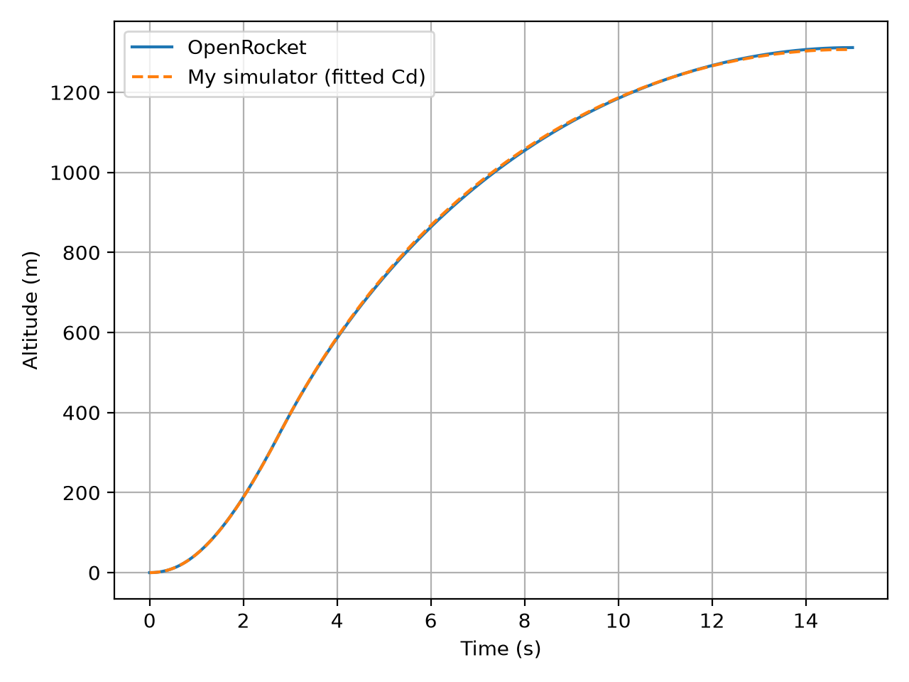
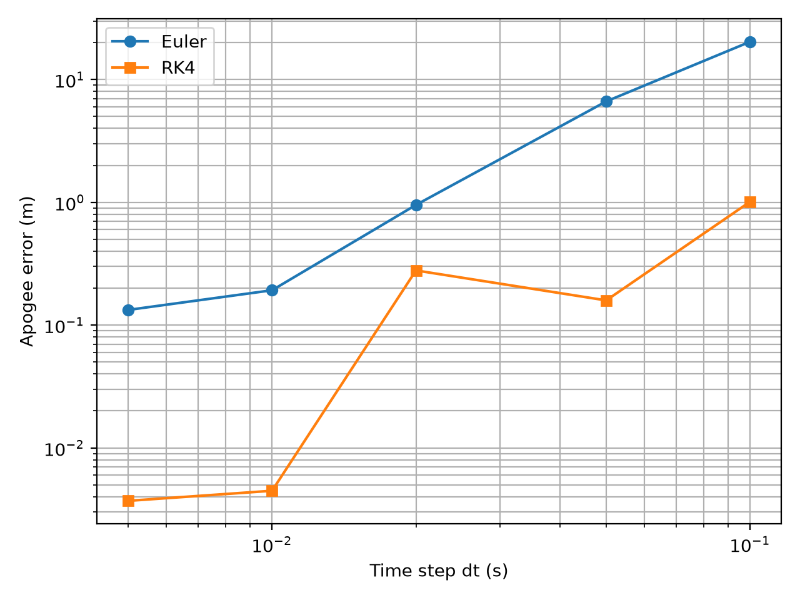
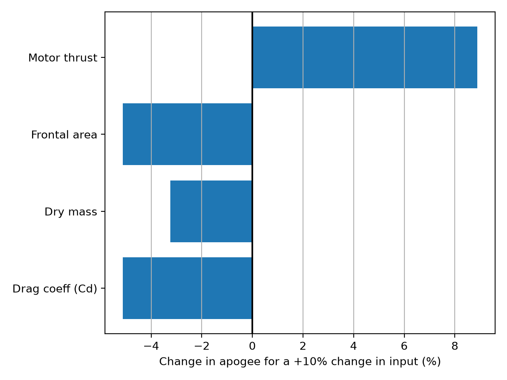
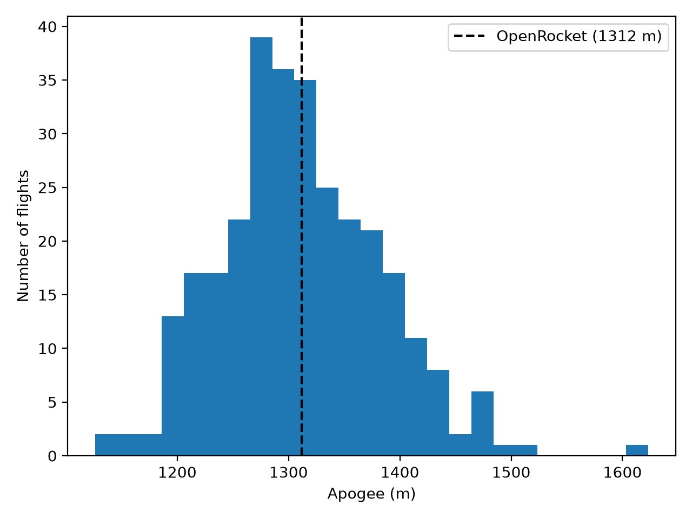

# Rocket Trajectory Simulator
A Python simulator that predicts the vertical flight of a model rocket (altitude, velocity, apogee) from its motor thrust curve, mass, drag, and air density. I verified the code against exact analytic solutions and validated it against OpenRocket, then ran sensitivity and Monte Carlo analyses to see how input uncertainty affects the prediction.

## Results at a glance
| Check | Result |
|---|---|
| Apogee, my simulator vs. OpenRocket (Cd from OpenRocket) | 1325 m vs. 1312 m (+1.0%) |
| Fitted drag coefficient | 0.415 (OpenRocket average: 0.40), altitude RMSE 2.5 m |
| Verification: no-drag analytic test | 4344.5491 m vs. 4344.5491 m |
| Verification: constant-density drag formula | 915.703 m vs. 915.703 m |
| Time-step convergence | RK4 apogee error about 5 mm at dt = 0.01 s |
| Monte Carlo (300 flights) | mean 1311 m, std 72 m, 90% between 1202 and 1432 m |



## What it models
- Thrust from a real motor thrust curve (RASP .eng file from ThrustCurve.org)
- Gravity, and quadratic drag with air density that falls with altitude
- Mass that decreases as propellant burns (in proportion to impulse delivered)
- RK4 numerical integration (time step 0.01 s)

## The rocket
Designed in OpenRocket (`data/rocket.ork`): 3 in diameter, 36.7 in long, 856 g without motor, 1420 g with an I-class motor (about 397 N·s total impulse), static stability 1.47 calibers. Reference simulation settings: wind 0 m/s, rod angle 0°, sea level, standard atmosphere.


## Verification (is the code solving the equations correctly?)
- With drag turned off, the simulated apogee matches v²/2g exactly.
- With constant air density, the coast gain matches the closed-form drag solution.
- RK4 converges much faster than Euler as the time step shrinks.



## Sensitivity and Monte Carlo
Changing each input by +10%: motor thrust gives +8.9% apogee, drag coefficient about −5%, frontal area −5.1%, dry mass −3.2%. (Cd and frontal area have the same effect because drag depends on their product.) The Monte Carlo run assumes Gaussian uncertainty of 8% on Cd, 2% on mass, and 3% on thrust, which are my assumptions.




## Limitations
- 1D vertical flight only: no wind, tilt, or weathercocking
- Constant drag coefficient (OpenRocket varies it with speed)
- Validated against OpenRocket, which is itself a model, not against real flight data
- Mass, motor data, and the baseline drag coefficient were taken from OpenRocket, so the comparison tests my dynamics and integration, not an independent drag estimate

## How to run
```
python -m venv .venv
.venv\Scripts\Activate.ps1
python -m pip install -r requirements.txt
python src/simulator.py
python src/verification.py
python src/analysis.py
```

## Repo layout
`data/` motor file, OpenRocket export, rocket design · `src/` code · `figures/` plots

## Tools
Python (NumPy, SciPy, pandas, Matplotlib), OpenRocket, Git/GitHub